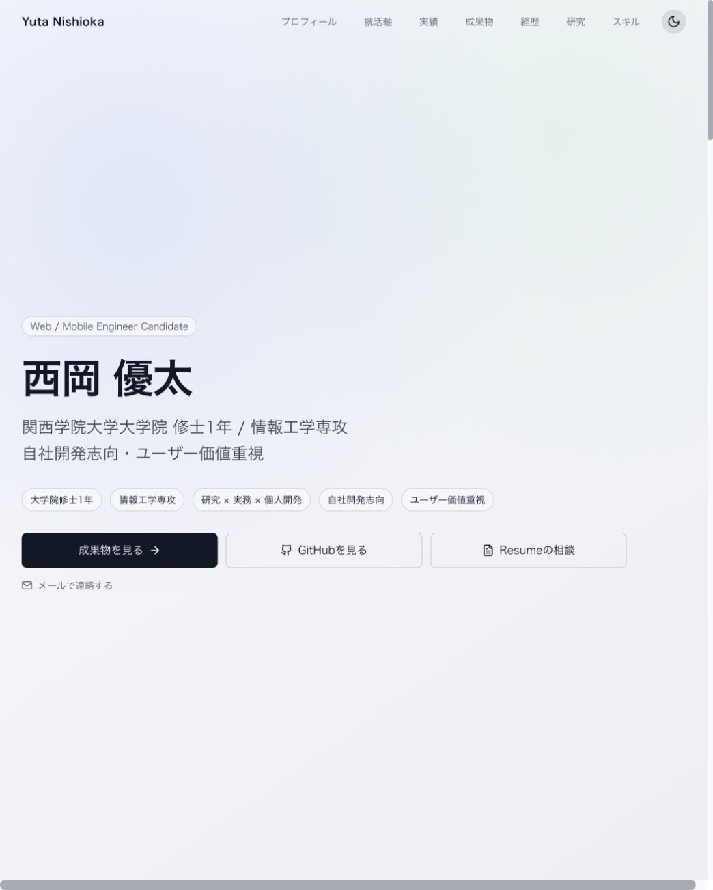

# 西岡優太のポートフォリオ

研究・実務・個人開発の取り組みを紹介するポートフォリオサイトです。

**公開URL:** https://portfolio-topaz-sigma-53.vercel.app

## スクリーンショット



## 主な内容

- プロフィール、就活軸、実績、成果物、経歴、研究、スキル
- ライト / ダークテーマの切り替え
- メールリンクからの連絡

## 技術スタック

| 用途 | 技術 |
| --- | --- |
| フレームワーク | Next.js 15（App Router）、React 19 |
| 言語 | TypeScript |
| スタイル | Tailwind CSS 4、clsx |
| アニメーション | Framer Motion |
| アイコン | Lucide React |
| 品質チェック | ESLint 9、TypeScript、GitHub Actions |
| ホスティング | Vercel |

## ローカル開発

Node.js 22 と npm を使用します。

```sh
npm ci
npm run dev
```

http://localhost:3000 を開いて確認できます。

## 品質チェックと本番ビルド

```sh
npm run lint
npm run typecheck
npm run build
npm start
```

`main` 向けのプルリクエストと `main` への push 時に、GitHub ActionsでLint・型チェック・ビルドを実行します。
既存のVercelデプロイワークフローは `main` への push 時に実行されます。

## コンテンツの編集

- `app/data/portfolioData.ts`: ナビゲーション、成果物、プロフィールのキーワードなど
- `app/components/AboutSection.tsx`: 所属・自己紹介
- `app/components/ExperienceSection.tsx`: 職歴・学歴
- `app/components/HeroSection.tsx`: トップページの紹介とリンク
